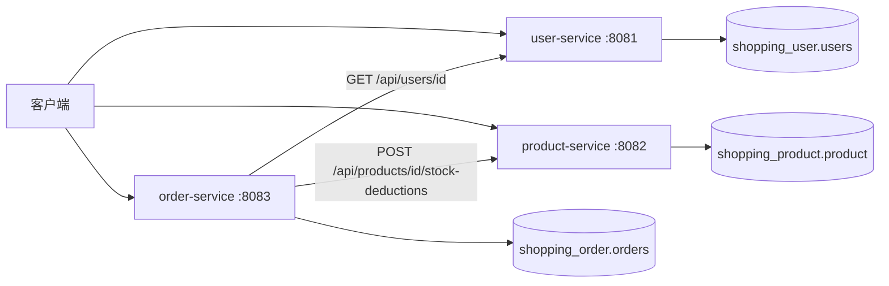

# 微服务拆分设计

单体购物系统保留在 `monolith/`。第 06 周按买家、商品、订单三条边界拆到 `services/`，每个服务只读写自己的库。

## 单体到微服务

| 单体内容 | 微服务 | 本服务拥有的数据 |
| --- | --- | --- |
| 订单里的买家姓名 | user-service | `users` |
| `Product`、库存和价格 | product-service | `product` |
| `Order`、金额和待支付状态 | order-service | `orders` |

订单不再使用 JPA 关联去读商品表。`orders` 只保存 `user_id` 和 `product_id`，姓名、商品名、单价由当次 HTTP 响应写入订单自己的列。库和库之间没有外键，服务之间也不调用对方的 Repository。

## 服务、端口和数据库

三个服务共用一个 MySQL 8.4.11 实例，各自使用独立数据库和独立账号。

| 服务 | 端口 | 数据库 | 账号 | 数据表 | 职责 |
| --- | --- | --- | --- | --- | --- |
| user-service | 8081 | shopping_user | user_app | users | 注册买家，按 ID 查询买家 |
| product-service | 8082 | shopping_product | product_app | product | 维护商品、价格和库存，提供扣减库存接口 |
| order-service | 8083 | shopping_order | order_app | orders | 校验买家和商品后创建待支付订单 |

## 调用关系

下单由 order-service 串起来。第 07 周起，订单服务每次通过 Nacos 分组 `CXT_SHOPPING` 发现实例，取第一个实例的地址再访问原来的业务路径：

1. `GET /api/users/{id}`。用户不存在时返回 404，不写订单，也不扣库存。发现不到 user-service 实例时返回 503。
2. `POST /api/products/{id}/stock-deductions`。商品不存在返回 404，数量超过库存返回 400。发现不到 product-service 实例或连接失败时返回 503。这些情况下 order-service 不写本地订单。
3. 两次调用都成功后，order-service 才把订单写入 `shopping_order`。金额等于商品单价乘以数量，状态为 `PENDING_PAYMENT`。

user-service 和 product-service 不互相调用。三个服务使用默认命名空间，分组都是 `CXT_SHOPPING`。注册中心地址用 `NACOS_SERVER_ADDR` 配置，容器里是 `nacos:8848`。RestTemplate 的连接超时是 2 秒，读取超时是 3 秒。

库存扣减在 product-service 提交成功之后，订单才开始写自己的库。如果扣库存已经成功，而订单写入失败，就会出现远端成功、本地失败：库存少了，订单却不存在。本周只把这个窗口说明清楚，不实现补偿。

