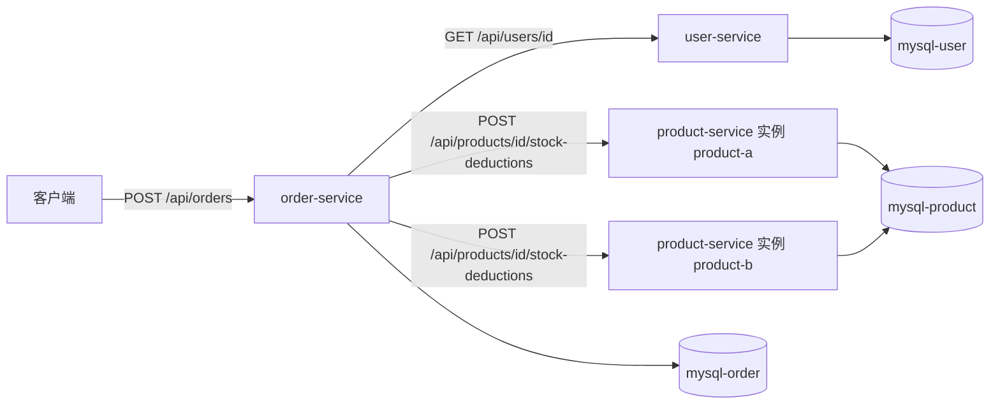

# 服务间调用

选择的跨服务流程是创建订单。买家和商品分别属于 user-service、product-service，订单属于 order-service。订单服务不能直接读另外两个库。

## 调用链路

调用方是 order-service。创建订单 `POST /api/orders` 时按下面的顺序调用：

1. 被调用方 user-service，`GET /api/users/{id}`。
2. 被调用方 product-service，`POST /api/products/{id}/stock-deductions`，请求体是 `{"quantity": 数量}`。
3. 两次调用都返回可用数据后，order-service 把订单写入自己的库 `shopping_order`。金额是单价乘以数量，状态是 `PENDING_PAYMENT`。

负载均衡探测使用 `GET /api/orders/upstream/products/{id}`。调用方仍是 order-service，被调用方是 product-service，路径是 `GET /api/products/{id}`。订单服务读取响应头 `X-Instance-Id`，返回 `{"instanceId","productId","name"}`。

OpenFeign 客户端只声明服务名：`UserClient` 的名字是 `user-service`，`ProductClient` 的名字是 `product-service`。实例列表来自 Nacos 分组 `CXT_SHOPPING`，由 Spring Cloud LoadBalancer 选择。负载均衡缓存已关闭。

## 数据库实例

三个业务库分属三个 MySQL 8.4.11 实例：

| 实例 | 数据库 | 使用它的服务 |
| --- | --- | --- |
| mysql-user | shopping_user | user-service |
| mysql-product | shopping_product | product-service-a、product-service-b |
| mysql-order | shopping_order | order-service |

商品库停止后，用户查询和已有订单查询仍然返回 200。新的下单因为调用商品服务失败，返回 503，订单数不增加。

## 失败与写操作结果

用户不存在返回 404，正文里的 `message` 是「用户不存在」。商品不存在或库存不足沿用商品服务返回的 4xx 和 `message`。连接失败、超时、实例列表为空，以及 5xx，统一返回 503，`message` 分别是「用户服务不可用」或「商品服务不可用」。这些情况下 order-service 不写入订单。

连接超时 2 秒，读取超时 3 秒。扣库存是写操作。调用方收到超时或连接中断时，只能确认订单没有记成成功，不能确认库存是否已经提交。2026-11-22 的端到端运行里，停止 `mysql-product` 后的下单返回 503，订单数保持不变；对应商品的库存却从 20 变成 18，而成功订单只有 1 笔。商品服务日志里同一次失败请求已经进入 `POST /api/products/{id}/stock-deductions`。因此这次写操作的结果是未知的，并且这次实际已经提交。本周不实现补偿。
